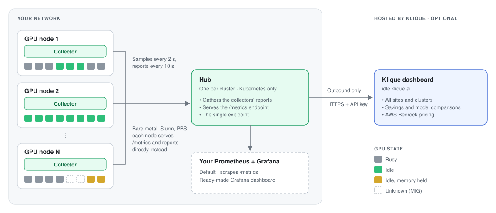
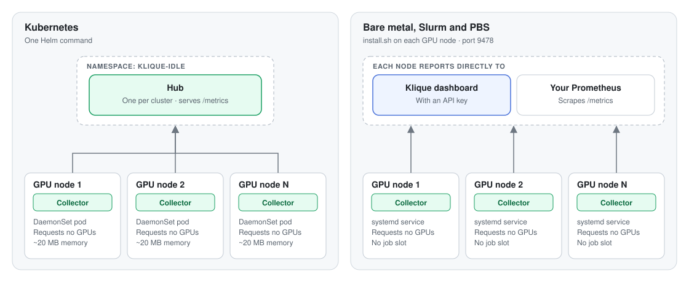

# Klique Idle GPU Dashboard

**Measure your potential savings: see how many tokens and dollars your idle GPUs are leaving on the table.**

Klique Idle GPU Dashboard is an open-source collector for NVIDIA GPU clusters running Kubernetes, Slurm, PBS or plain Linux servers. It measures how much of your GPU capacity sits idle, when it sits idle, and where. It then translates that idle time into something concrete: how many tokens those GPUs could have generated with a model you choose, and what those tokens are worth at that model's market price on AWS Bedrock.

Most clusters have more idle capacity than their owners realize. It hides in the gaps between jobs, overnight and weekend lulls, partly used nodes, and GPUs held by notebooks nobody is using. Klique Idle GPU Dashboard makes that capacity visible, so you can decide what to do with it.

> **Observe-only.** Klique Idle GPU Dashboard requests no GPUs and runs nothing on them. It reads utilization statistics and reports them. Your scheduled jobs are never affected.

---

## Why it matters

GPUs are the most expensive part of an AI cluster, and most of them are busy far less often than their owners assume. Industry estimates put typical idle capacity at 20–45% of a cluster, and published research and surveys point the same way:

| Finding | Source |
|---|---|
| GPU utilization averaged **5%** across the Kubernetes clusters analyzed, drawn from tens of thousands of clusters. | [Cast AI, 2026 State of Kubernetes Optimization Report](https://cast.ai/press-release/2026-state-of-kubernetes-optimization-report/) (April 2026) |
| More than **80%** of enterprises that run their own GPUs report utilization of 50% or less. | [VentureBeat Research survey of 573 technical leaders](https://venturebeat.com/orchestration/wall-street-is-debating-the-ai-buildout-enterprises-just-answered-86-say-their-gpus-run-at-half-capacity-or-less) (July 2026) |
| In a 6,742-GPU production cluster at Alibaba, the median job used **4.2%** of a GPU's compute, and only 7% of measurements showed heavy (95%+) utilization. | [Weng et al., "MLaaS in the Wild", NSDI 2022](https://www.usenix.org/conference/nsdi22/presentation/weng) |
| In Microsoft's multi-tenant deep learning cluster, GPUs that were allocated to jobs averaged about **52%** utilization, so nearly half their cycles went unused. | [Jeon et al., "Analysis of Large-Scale Multi-Tenant GPU Clusters for DNN Training Workloads", USENIX ATC 2019](https://arxiv.org/abs/1901.05758) |

These are industry numbers, but every cluster is unique. Your workloads, schedules and teams leave gaps that no survey can predict. Finding your real number is now easy and free: install Klique Idle GPU Dashboard, and within a day you'll see exactly how much of your GPU capacity sits idle, where it hides, and what it's worth.

---

## What you get

- **A live map of every GPU** in every cluster: busy, idle, idle but holding memory, or offline.
- **Idle history** per GPU, per node and per cluster, over 24 hours, 7 days, 30 days and 12 months.
- **A savings estimate in dollars and tokens**, based on a model you pick and real per-GPU throughput.
- **One view across sites and clusters** in the hosted dashboard.
- **Your data, your way:** a standard Prometheus endpoint and a ready-made Grafana dashboard, so you can keep everything in-house.
- **Concrete tips** for recovering capacity, such as nodes that suit a smaller model, GPUs held by stale jobs, and recurring idle windows.

## Who it's for

| If you are… | Klique Idle GPU Dashboard helps you… |
|---|---|
| **A cluster or infrastructure admin** (Kubernetes, Slurm, PBS or bare metal) | See real idle patterns per node and GPU, find stuck or forgotten allocations, and spot nodes that are reserved but unused. Without touching the scheduler. |
| **An MLOps or platform engineer** | Size how much internal inference capacity is already sitting in the cluster, and which models fit the hardware you have. |
| **FinOps or infrastructure leadership** | Put a dollar figure on unused capacity, compare it with commercial API spend, and track utilization across sites over time. |

---

## How it works

Klique Idle GPU Dashboard runs a small **collector** on every GPU node. Every 2 seconds it reads:

- **The GPUs**, through NVML, the library that ships with the NVIDIA driver: utilization, memory, power, temperature and the processes using each GPU.
- **The host**, through `/proc`: CPU and memory use, and which process belongs to which pod or job.
- **The scheduler**, if there is one: pod and job names, and which GPUs are allocated.

Every 10 seconds it sends a short report with the average and the peak of its last five samples, so short bursts of work are never mistaken for idle time. Each report says which pod or job owns each GPU.

Where those reports go depends on how you install it:

| | Kubernetes | Bare metal, Slurm and PBS |
|---|---|---|
| **Collector** | A DaemonSet pod on each GPU node | A systemd service on each GPU node |
| **Hub** | One per cluster. Gathers the collectors' reports inside the cluster, serves the Prometheus endpoint, and is the only component that talks to the hosted dashboard. | Not used. Each node serves its own Prometheus endpoint and reports directly. |

Every installation can send its data to any of these, separately or together:

- **Your own Prometheus and Grafana** (the default), through a standard `/metrics` endpoint. A ready-made Grafana dashboard is included, and nothing leaves your network.
- **The hosted Klique dashboard** at `idle.klique.ai`, once you add an API key.
- **Your own server**, which receives the same reports. The report format is documented in [docs/payload.md](docs/payload.md).





### Platform status

| Part | Status |
|---|---|
| Collector (Go, single binary, amd64 and arm64) | Ready. Validated on an NVIDIA H100: utilization, memory, power and process attribution match `nvidia-smi`. |
| Hub (Prometheus metrics, Grafana dashboard, hosted dashboard forwarding) | Ready. Validated end to end with Prometheus and Grafana. |
| Kubernetes (Helm chart) | Ready. Tested with NVIDIA GPU Operator v25.3.4 and v26.7.1, with CDI on and off, on vanilla and hardened setups ([results](docs/gpu-operator-compatibility.md)). |
| Bare metal (systemd service and installer) | Ready. Validated on H100 with driver 580; install, upgrade and uninstall tested. |
| Slurm | Ready. Tested against Slurm 23.11, including the no-root batch-job option. |
| PBS (OpenPBS and PBS Professional) | Preview. Written against PBS's documented interfaces, not yet run on a live PBS cluster. |

---

## Getting started

The hosted dashboard's **Add cluster** page generates the exact install command for your cluster. These are the same commands, written out.

### What you'll need

| Value | Required | What it is |
|---|---|---|
| **Cluster name** | Yes | A human-readable name, unique across your organization. This is how the cluster appears on the dashboard. |
| **API key** | No | Your key for the hosted dashboard, from [idle.klique.ai](https://idle.klique.ai). Without it, nothing leaves your network. |

### Kubernetes

**Prerequisites:** the NVIDIA driver and the NVIDIA container toolkit on the GPU nodes. The NVIDIA GPU Operator installs both, and a standard GPU Operator setup works out of the box.

One Helm command installs the collectors and the hub. The chart is public on Docker Hub, so there's no Helm repository to add:

```sh
helm install klique-idle oci://registry-1.docker.io/kliqueai/klique-idle \
  --namespace klique-idle --create-namespace \
  --set cluster=<cluster-name>
```

Nothing leaves the cluster until you choose where the data goes:

| Destination | Add to the command |
|---|---|
| **Your Grafana**, with kube-prometheus-stack | `--set metrics.serviceMonitor.enabled=true --set metrics.serviceMonitor.labels.release=<its release name> --set grafanaDashboard.enabled=true`. For any other Prometheus setup, see [docs/grafana.md](docs/grafana.md). |
| **The hosted dashboard** | `--set cloud.apiKey=<api-key>`, or `--set cloud.existingSecret.name=<secret>` to read the key from an existing Kubernetes Secret |
| **Your own server** | `--set endpoint=https://your-server/v1/reports --set hub.enabled=false`. The collectors then post straight to your server. |

- **Where it runs.** The collector DaemonSet runs on nodes labeled `nvidia.com/gpu.present=true`, which GPU Operator nodes are. Set `nodeSelector` if your labels differ.
- **How it reads GPUs.** Through the NVIDIA runtime, with `NVIDIA_VISIBLE_DEVICES=all` and the utility capability only. It **doesn't request `nvidia.com/gpu`**, so it never takes a GPU away from workloads.
- **What it needs.** `hostPID`, to match GPU processes to pods, and read-only RBAC permissions (get nodes, list pods). It runs as non-root, on a read-only filesystem, with no Linux capabilities.

See [charts/klique-idle/values.yaml](charts/klique-idle/values.yaml) for every option.

### Bare metal

This is also the recommended install on Slurm and PBS nodes.

**Prerequisites:** Linux with systemd, the NVIDIA driver on the node, and root access to install.

Download the release bundle for your architecture and run the installer on each GPU node:

```sh
tar xzf klique-idle-collector-<version>-linux-amd64.tar.gz
cd klique-idle-collector-<version>-linux-amd64
sudo ./install.sh --cluster <cluster-name> --labels site=<site-name>
```

The installer:

1. Creates an unprivileged `klique-idle` user, so the collector doesn't run as root.
2. Installs a hardened systemd service.
3. Runs a self-test that shows what the node would report.
4. Starts the service.

Running it again upgrades in place, and `--uninstall` removes it. To roll it out to many nodes, use your usual tool, for example `pdsh -w gpu[01-64] 'sudo /shared/kic/install.sh ...'`.

Choose where the data goes:

- **Your Grafana (the default).** Every node serves its metrics at `/metrics` on port `9478`, but only to the node itself by default. Add `--listen :9478` so a Prometheus on another host can scrape it, then import the dashboard ([docs/grafana.md](docs/grafana.md)). Nothing else leaves the node.
- **The hosted dashboard.** Add `--endpoint https://idle.klique.ai/v1/reports --token-file <file-containing-your-api-key>`. The `/metrics` endpoint stays on. See [deploy/systemd](deploy/systemd/README.md).

### Slurm and PBS

Install the service on every GPU node as described above. The collector detects the scheduler by itself and adds job names and GPU allocation to its reports. It runs outside the scheduler, so it takes no job slot and can't be preempted.

If you can't install a service on the nodes, there's a no-root option that runs the collector as one batch job per GPU node instead (`submit-collectors.sh` on Slurm). Each job requests **0 GPUs, 1 CPU and 200 MB of memory**, so it never blocks real work. It has limits: a job ends at the partition's time limit and isn't resubmitted automatically, and if it's preempted it follows your cluster's preemption settings. Use the service install wherever you can.

See [deploy/slurm](deploy/slurm/README.md) and [deploy/pbs](deploy/pbs/README.md).

### Try it without GPUs

```sh
cd collector
make run-fake        # reports from 8 simulated GPUs, printed to the terminal
make kind-demo       # local 3-node Kubernetes cluster with simulated GPUs and the hub
```

Simulated reports are marked `"gpu_source": "fake"`.

### Hosted dashboard or your own Grafana?

| | Hosted dashboard | Your own Prometheus and Grafana |
|---|---|---|
| What leaves your network | The reports described in [What leaves the node](#what-leaves-the-node), over HTTPS to `idle.klique.ai` | Nothing |
| What you see | Every site and cluster, savings estimates, model comparisons and tips | A ready-made Grafana dashboard of GPU utilization and idle time, to build on |
| Data retention | Detailed 10-second data for 7 days, hourly summaries for about 13 months | Up to your own Prometheus |
| Best for | Multi-site fleets, leadership and FinOps reporting | Air-gapped or regulated environments, and teams with an existing monitoring stack |

You can use both at once. The Klique dashboard is available only as a hosted service. To keep everything on-premises or air-gapped, send the metrics to your own Prometheus and Grafana instead.

### After you deploy

1. **Nodes start reporting.** The hosted dashboard shows the number of reporting nodes rising to the total. On Kubernetes, the hub appears first.
2. **Live tiles appear right away.** Savings projections firm up after about **24 hours** of samples, and become more representative as history builds up over weeks.

---

## Using the dashboard

### Fleet view

The top of the dashboard answers three questions for your whole organization:

- **Potential savings (per year):** what your recent idle capacity would be worth if it generated tokens, based on the last 30 days.
- **Left on the table:** what the idle time recorded over the last 12 months would have been worth, at today's prices.
- **Idle right now:** how many GPUs have been idle for at least the last 10 minutes, how many tokens per second they could produce, and roughly how many concurrent users that would serve.

Below that, switch between **sites** with the tabs, and scroll through the **clusters** in each site.

### Cluster card

Each cluster gets a card with:

- **GPU map:** one cell per GPU, colored by state (see [GPU states](#gpu-states)).
- **Nodes, most idle first:** per-GPU bars plus a 24-hour compute and memory trace, with whole-node idle periods highlighted.
- **Token model selector:** pick the model you'd run on this cluster's idle GPUs. The card shows how many GPUs one replica of that model needs on this hardware, and recalculates everything.
- **Projected savings and left on the table** for this cluster.
- **Idle now, harvestable now** (tokens per second and number of replicas) and **concurrent users**.
- **Idle GPUs over time** for 24 hours, 7 days, 30 days or 12 months.
- **Tips**: observations specific to this cluster's idle patterns (see [Getting value](#getting-value-from-klique-idle-gpu-dashboard)).
- **How is this calculated?** opens the full savings breakdown with adjustable assumptions.

### Node detail

Click any node to see:

- Collector status and last heartbeat.
- Idle GPUs right now, idle GPU-hours over the last 24 hours, and the tokens those hours could have produced.
- Host CPU and memory, GPU model and memory.
- A per-GPU table with current state, compute, memory, a 24-hour trace, and idle (or memory-held) hours.
- An **Eligible for Klique** toggle. Turn it off for nodes you keep free on purpose, such as hot spares or interactive nodes, so they don't inflate your numbers.

### GPU states

| State | Meaning |
|---|---|
| **Busy** | Utilization reached 5% or more. The cell fills to the GPU's utilization. |
| **Idle (free)** | Utilization under 5%, and under 5% of the GPU's memory in use. Counted toward savings. |
| **Idle (memory held)** | Utilization under 5%, but 5% or more of the GPU's memory still in use, usually a stale notebook or a hung job. **Not** counted toward savings, but flagged as reclaimable. |
| **Offline** | No heartbeat from the node's collector. |
| **Unknown** | Utilization or memory isn't reported, as with GPUs split into MIG partitions. Never counted as idle. |

Each GPU gets a state for every 10-second report, based on that window's **peak**, not its average. A GPU that touches 5% utilization even once in those 10 seconds counts as busy, so short bursts of work are never mistaken for idle time.

Two views use these states differently:

- **Idle right now** counts a GPU only after it has been idle for 10 minutes in a row, so short gaps between jobs don't show up as available capacity.
- **Idle hours and savings** count every idle window, however short.

The thresholds are the same for every customer on the hosted dashboard.

### Use your own monitoring stack

The hosted dashboard is optional. Klique Idle GPU Dashboard exposes everything it collects through a standard Prometheus `/metrics` endpoint, in Prometheus text format, so any compatible tool can scrape it: Prometheus, the OpenTelemetry Collector, Grafana Alloy and others.

- **On Kubernetes**, the hub serves the endpoint, one per cluster.
- **On bare metal, Slurm and PBS**, each node serves it on port `9478`, to the node itself by default. Install with `--listen :9478` to let a Prometheus on another host scrape it.
- **A ready-made Grafana dashboard** is included to start from ([setup](docs/grafana.md)). It counts a GPU as idle when its utilization stays under 5% for 10 minutes.
- **A small JSON API** at `/v1/nodes` returns the latest report from each node.

There's no database to run. Your Prometheus stores the history, for as long as you keep it.

---

## How savings are calculated

Klique Idle GPU Dashboard turns idle GPU time into dollars in six steps:

1. **Measure idle GPUs** for the period: the 30-day average for *projected savings*, the 12-month record for *left on the table*.
2. **Keep only the idle capacity the model can use.** A model that fits on one GPU can use every idle GPU. A model that needs a whole 8-GPU node can only use time when the *entire* node was idle. Larger footprints are discounted accordingly.
3. **Divide by GPUs per replica** to get the number of model replicas that would fit.
4. **Multiply by benchmarked throughput** for that model on that GPU type, taken from public vLLM and NVIDIA benchmarks, to get tokens per second.
5. **Convert to tokens per year.**
6. **Value those tokens** at the market price for that model on AWS Bedrock (on-demand price per 1M output tokens).

Tokens generated on your own idle GPUs are free: the hardware is already paid for. So their market value is what you save by not buying the same tokens elsewhere. If your local GPUs ran model X, you would get $Y of tokens from them.

The numbers are deliberately conservative:

- Only **output tokens** are counted. Input tokens are ignored.
- **Memory-held** GPUs are excluded until reclaimed.
- Days before the collectors were installed count as **zero**. Klique Idle GPU Dashboard never back-fills estimates.

You can adjust the assumptions in the *How is this calculated?* panel:

- **Speed per user**, which changes the concurrent-user estimate.
- **Power cost**, to show net savings rather than gross.
- **Internal demand**: the share of generated tokens your teams would actually use. At 100% the figure is a ceiling, which is why it's called *potential* savings. Set it to what you'd realistically consume for a planning number.

### Models

The model selector covers leading open-weight models, including:

- Kimi K3 (Moonshot AI)
- GLM 5.3 (Z.ai)
- DeepSeek V3.2 (DeepSeek)
- Qwen3 Coder 480B (Alibaba)
- Mistral Large 3 (Mistral AI)
- Nemotron 3 Super (NVIDIA)
- gpt-oss-120b (OpenAI)
- Gemma 4 31B (Google)

We add new models as they're released. A model is included only once it's available on AWS Bedrock, so every savings figure is based on a real market price.

---

## Getting value from Klique Idle GPU Dashboard

Collecting the data is the first step. This is how teams typically turn it into savings or better utilization.

**1. Establish a baseline.** Let it run for at least a week, ideally a month, before drawing conclusions. Idle patterns are often weekly, and a single day can mislead.

**2. Look for time patterns.** If idle peaks overnight and on weekends, that capacity is predictable. It can be scheduled for batch inference, evaluation runs, synthetic data generation, or other internal workloads that don't need to run during working hours.

**3. Reclaim memory-held GPUs.** GPUs at 0% compute that still hold memory are usually abandoned notebooks or hung jobs. They block the scheduler without doing any work. Cleaning them up is often the fastest win, and costs nothing.

**4. Match the model to the shape of your idle time.** Large models that need a whole node only fit into fully idle nodes. If most of your idle capacity is scattered across partly busy nodes, a model that fits on one GPU will capture far more of it. Try different models in the selector and watch the numbers change. The tips on each cluster card point out when a different model would earn more.

**5. Exclude what's idle on purpose.** Turn off *Eligible for Klique* on hot spares, interactive nodes and anything else you deliberately keep free, so your reported numbers reflect real opportunity.

**6. Use reserved capacity.** If a cluster runs on reserved or committed cloud instances, its idle hours are already paid for. Any useful work you run there is close to free.

**7. Bring the numbers to the conversation.** Use *left on the table* and *potential savings* to inform capacity planning, budget reviews and commercial API spend decisions. Compare across sites to see where utilization lags.

**8. Put the capacity to work with Klique.** Once you know how much free capacity you have and which model suits it, Klique lets you act on it: run models on your own GPUs and route your teams' AI traffic to them through Klique's LLM gateway. See [Acting on your idle GPUs](#acting-on-your-idle-gpus).

---

## Acting on your idle GPUs

Klique Idle GPU Dashboard shows you the opportunity. [Klique](https://klique.ai) is how you act on it. Run models on your own GPUs, route your teams' AI calls through Klique's LLM gateway, and manage usage with Klique's projects, budgets and governance. Every cluster you connect to the dashboard is eligible for the full Klique offering.

---

## What leaves the node

Each report is one JSON document ([format](docs/payload.md), [example](docs/examples/report-h100-busy.json)) containing:

- **Node:** name, OS, kernel, CPU model and count, total memory, NVIDIA driver version, and any `--labels` you set.
- **Host:** CPU and memory use (average and peak).
- **Per GPU:** model, UUID, total memory, utilization and memory use (average and peak), power and temperature.
- **Per GPU process:** process ID, name, user and GPU memory, and the pod (name and namespace) or job (ID, name, user and queue) that owns it.
- **Scheduler view:** GPUs allocatable and allocated, and on Slurm, which job holds which GPU.

Names are included by default. `--redact` replaces user, job, pod and process names with hashes, which stay stable within a cluster so grouping still works. Process command lines are **not** sent unless you pass `--include-cmdline`, because they can contain secrets passed as arguments.

---

## Security and privacy

- **Observe-only.** The collector reads GPUs through NVML and requests no GPUs, so it never takes one away from your workloads.
- **Read-only.** It never creates a CUDA context, never changes GPU settings and doesn't write to disk.
- **Nothing leaves without an API key or an endpoint you set.** By default, all data stays in your network.
- **Outbound only.** With an API key, reports go out over HTTPS on port 443 to `idle.klique.ai`, authenticated with the key. Nothing connects in. The collector's only other network traffic is to the Kubernetes API, on Kubernetes.
- **One exit point on Kubernetes.** Only the hub talks to the outside. The collectors talk only to the hub, inside the cluster. On bare metal, Slurm and PBS, each node sends its own reports under the same rule.
- **Least privilege.** On Kubernetes, it runs as non-root on a read-only filesystem with no Linux capabilities, using `hostPID` and read-only RBAC permissions. On bare metal, it runs as an unprivileged `klique-idle` user. On Slurm and PBS, it also runs the scheduler's read-only commands (`scontrol` and `squeue`, or `pbsnodes` and `qstat`).
- **Retention on the hosted dashboard:** detailed 10-second data is kept for 7 days, and hourly summaries for about 13 months. Savings and idle-hour figures are calculated from the hourly summaries.
- **Small footprint.** On Kubernetes, the collector requests 10m CPU and 32 MiB of memory, with a 128 MiB limit, and uses about 15–20 MB in practice. As a Slurm batch job, it uses 1 CPU and 200 MB.

---

## Configuration reference

On Kubernetes, configure the collector and hub through Helm values. [charts/klique-idle/values.yaml](charts/klique-idle/values.yaml) lists every option. On bare metal, Slurm and PBS, pass the collector's flags to `install.sh`.

`klique-idle-collector --help` lists every flag. Each flag can also be set as an environment variable: `--report-interval` becomes `KLIQUE_IDLE_REPORT_INTERVAL`. Flags take precedence over environment variables.

| Flag | Default | What it does |
|---|---|---|
| `--cluster` | | Cluster name on the dashboard. Required when you set an endpoint. |
| `--endpoint` | | URL to send reports to. If empty, reports are printed to stdout. |
| `--token-file` / `--token` | | API key (bearer token), from a file or directly |
| `--labels` | | Labels sent with every report, for example `site=sjc-1,rack=b4` |
| `--sample-interval` | `2s` | How often the node is read |
| `--report-interval` | `10s` | How often a report is sent |
| `--gpu` | `nvml` | `nvml`, `fake` (simulated GPUs) or `none` |
| `--scheduler` | `auto` | `auto`, `kubernetes`, `slurm`, `pbs` or `none` |
| `--redact` | `false` | Replace user, job, pod and process names with hashes |
| `--include-cmdline` | `false` | Send GPU process command lines |
| `--queue-size` | `360` | Reports kept while the server is unreachable |
| `--gzip`, `--ca-file`, `--insecure-skip-verify` | | Delivery options |
| `--health-addr` | `127.0.0.1:9478` | Address for `/healthz` and `/metrics`. Use `:9478` for every interface, or `off` to disable them. |
| `--print-reports` | `true` | With no endpoint, print reports to stdout. Set to `false` to only serve `/metrics`. |
| `--once` | | Print one report and exit: exactly what would be sent |

---

## Operating it

- **See exactly what a node sends:**
  - Kubernetes: `kubectl -n klique-idle exec daemonset/klique-idle-collector -- klique-idle-collector --once`
  - Service: `sudo -u klique-idle bash -c 'set -a; . /etc/klique-idle-collector/collector.env; klique-idle-collector --once'`
- **Check health:** `curl -s localhost:9478/healthz` returns the collection loop's state, the last report and delivery statistics (pending, sent, dropped, last error).
- **Find problems** in the `errors` field of each report and in the logs:

| Message | Meaning |
|---|---|
| `NVIDIA driver library libnvidia-ml.so.1 not found` | There's no driver, or on Kubernetes the pod didn't get the NVIDIA runtime: check `nvidia.runtimeClassName`. The collector keeps retrying, so a driver that loads later is picked up. |
| `GPU processes are not visible in /proc` | Enable `hostPID` on Kubernetes. On hosts with `/proc` mounted with `hidepid=2`, install with `--run-as-root`. |
| `NVML init: Insufficient Permissions` | The collector's non-root user can't read `/dev/nvidia*`. The installer adds the user to the devices' group automatically. On Kubernetes, set `podSecurityContext.runAsUser=0`. |
| `kubernetes API ... 403` | RBAC permissions are missing. Set `rbac.create=true`. |
| `cannot start health endpoint ... address already in use` | Another collector is already running on the node. |

---

## FAQ

**Will this slow down or interfere with my jobs?**
No. Klique Idle GPU Dashboard only reads statistics and requests no GPUs. It never creates a CUDA context or changes GPU settings. On Kubernetes, the collector uses about 15–20 MB of memory. On Slurm and PBS, the service install takes no job slot at all, and the batch-job option uses 1 CPU and 200 MB.

**Why don't the savings show up straight away?**
Live tiles appear immediately, but projections need at least 24 hours of samples, and get more reliable as history accumulates.

**Why does my savings figure change when I switch models?**
Each model needs a different number of GPUs per replica and runs at a different speed on each GPU type. A large model can only use fully idle nodes, while a small one can use any idle GPU.

**Are the dollar figures what I'd actually save?**
They show what the idle capacity would be worth if your teams consumed the tokens, valued at what the same model costs on AWS Bedrock. Use the *internal demand* and *power cost* settings to turn the ceiling into a realistic planning figure.

**Does it work in an air-gapped environment?**
Yes. Install without an API key and nothing leaves your network. Send the metrics to your own Prometheus and Grafana, and use the bundled Grafana dashboard to see utilization and idle time. The Klique dashboard itself, with its savings estimates and model comparisons, is available only as a hosted service and can't be installed on-premises.

**Which environments are supported?**
Kubernetes, Slurm, and bare-metal Linux servers with systemd, on amd64 and arm64. PBS (OpenPBS and PBS Professional) support is in preview. The release binaries need glibc 2.17 or later, so they run on any mainstream Linux distribution from the last decade.

**Can I check exactly what gets sent before connecting anything?**
Yes. Run the collector with `--once` to print one report and exit, or leave the endpoint empty and it prints every report to the terminal.

**Can I hide user, job and process names?**
Yes. Install with `--redact` to replace them with hashes that stay stable within a cluster, so grouping still works.

**Which GPUs are supported?**
NVIDIA GPUs only, for now: any NVIDIA data-center GPU that the NVIDIA driver supports. It has been tested on H100 and T4 GPUs, with drivers 580 and 595 and GPU Operator v25.3.4 and v26.7.1. GPUs split with MIG show as unknown, because MIG partitions don't report utilization.

---

## Development

```
collector/            Go module: the collector and the hub
  cmd/                klique-idle-collector, klique-idle-hub
  internal/           report (data contract), gpu (NVML and simulator), host, owner,
                      scheduler (kubernetes, slurm, pbs), sender, collector, config, health,
                      hub (metrics, forwarding), envflag
charts/               Helm chart (collector DaemonSet and hub) and the Grafana dashboard
deploy/               systemd unit and installer, Slurm and PBS guides
docs/                 data contract and examples
```

```sh
cd collector
make test            # unit tests with the race detector; runs on macOS too
make dist            # Linux amd64 and arm64 binaries
make bundle          # per-architecture tarballs: binary, install.sh and systemd unit
make image           # multi-architecture container image
```

The collector talks to NVML through NVIDIA's [go-nvml](https://github.com/NVIDIA/go-nvml), which needs cgo. Release binaries are built on AlmaLinux 8, and the build checks that they need no more than glibc 2.17.

---

## Contributing

Found a bug or have an idea? [Open an issue on GitHub](../../issues).

Contributions are welcome, including ones made with the help of AI tools, as long as a person has reviewed, tested and understands what they submit. Low-effort, unreviewed AI-generated pull requests will be closed without review. See [CONTRIBUTING.md](CONTRIBUTING.md) for how to report bugs, propose changes and submit pull requests.

---

## License

Copyright 2026 ClearML Ltd. The collector and hub are licensed under [Apache 2.0](LICENSE). The hosted Klique dashboard is a Klique service and is not part of this repository.
